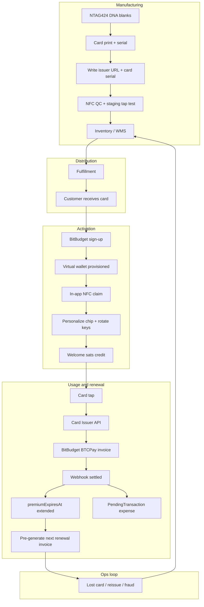
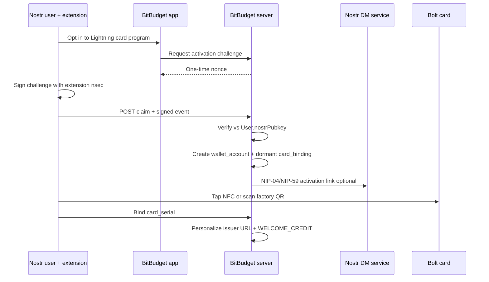
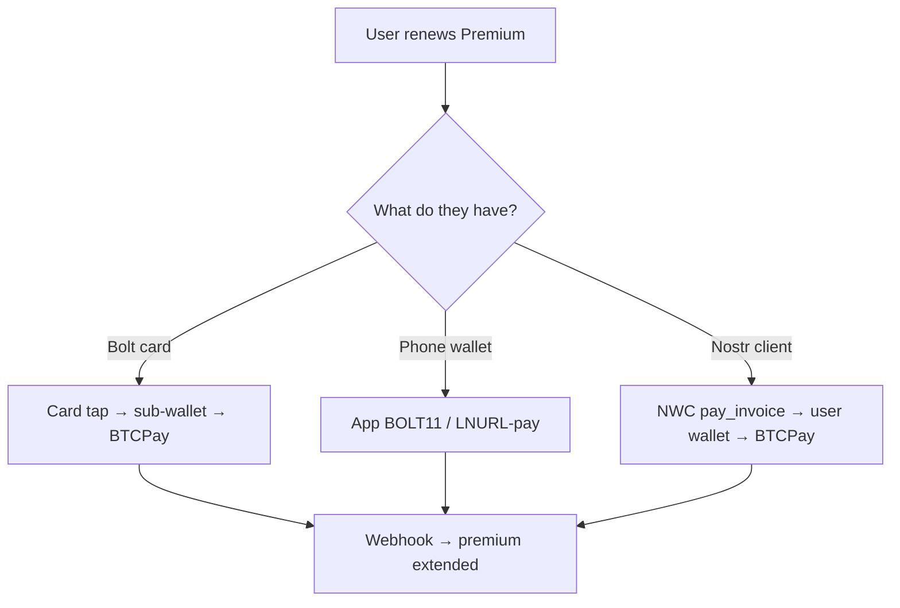

# Bolt Card Platform — Product & Manufacturing Plan

Hypothetical architecture for BitBudget welcome-gift Bolt cards and premium renewal by card tap. Complements BTCPay premium checkout work and operator setup in [startos-v04.md](startos-v04.md).

**Status:** Design notes only — not shipped product. Custodial Lightning wallets are a separate product line from E2E-encrypted budgeting data; require explicit opt-in and plain-language privacy warnings per AGENTS.md.

---

## Table of Contents

1. [Goals and role model](#1-goals-and-role-model)
2. [End-to-end lifecycle](#2-end-to-end-lifecycle)
3. [Manufacturing and inventory](#3-manufacturing-and-inventory)
4. [Card programming](#4-card-programming)
5. [Distribution and activation](#5-distribution-and-activation)
6. [Nostr activation path (privacy)](#6-nostr-activation-path-privacy)
7. [Premium renewal by card tap](#7-premium-renewal-by-card-tap)
8. [Virtual ledger schema](#8-virtual-ledger-schema)
9. [Scale phases](#9-scale-phases)
10. [System components](#10-system-components)
11. [Operational upkeep](#11-operational-upkeep)
12. [Risks and mitigations](#12-risks-and-mitigations)
13. [Payment rail choice: card vs phone](#13-payment-rail-choice-card-vs-phone)
14. [First milestone](#14-first-milestone)
15. [Related docs](#15-related-docs)

---

## 1. Goals and role model

**Goals**

- Welcome gift: physical Bolt card + optional welcome sats so users can try tap-to-pay once.
- Premium renewal: user taps card to pay BitBudget’s BTCPay invoice ($5/mo Lightning, $50/yr Lightning or on-chain annual).
- “Left wallet at home”: card works without user-owned Lightning wallet on phone; app also offers BOLT11 / LNURL and NWC (see [lightning-nostr-operations.md](lightning-nostr-operations.md)).

**Correct merchant role**

Users pay **BitBudget**; BitBudget is the **merchant** (inbound Lightning), not an outbound payer for subscription taps. See [lightning-nostr-operations.md](lightning-nostr-operations.md) for liquidity implications.

**Core design principles**

| Principle | Detail |
|-----------|--------|
| Blank-at-factory, bound-at-activation | Chip ships with issuer URL + serial only; no user PII until in-app claim |
| Virtual wallets at scale | Do not open one LND channel per user at 10M; ledger + pooled treasury |
| Same stack as BTCPay checkout | Tap settles BTCPay invoice → webhook → `premiumExpiresAt` → auto-budget `PendingTransaction` |
| Privacy separation | Custodial card wallet is opt-in, disclosed separately from E2E transaction encryption |

**Pricing (aligned with premium checkout)**

- $5/mo Lightning
- $50/yr Lightning (two months free vs monthly)
- $50/yr on-chain (annual minimum for on-chain)

---

## 2. End-to-end lifecycle



---

## 3. Manufacturing and inventory

| Step | Stage | Detail |
|------|-------|--------|
| 1 | Procurement | NTAG424 DNA (or equivalent secure NFC) from approved fab; verify UID entropy and anti-cloning |
| 2 | Artwork | Physical card print (welcome branding); UID laser/emboss traceability |
| 3 | Factory enroll | Write issuer URL template + card serial; **no user PII on chip** |
| 4 | QC | NFC read-back, URL reachability smoke test, sample tap against staging LNbits |
| 5 | Inventory | Serialized stock in WMS; chain-of-custody to activation event |
| 6 | Fulfillment | Ship with activation code or in-app claim; card **dormant** until bound |

**Chip contents at factory**

```
https://card.bitbudget.io/c/{card_serial}
```

Dormant until user claims and issuer personalizes the endpoint.

**Hardware**

- NTAG424 DNA or compatible (NXP SUN authentication where used)
- NFC programming: Bolt Card NFC app (Android Chrome) at small scale; factory NFC writer at volume
- Clearnet issuer URL required on chip (not `.onion` or `.local`) — see [startos-v04.md](startos-v04.md) StartTunnel

---

## 4. Card programming

Two programming moments:

### Factory (bulk)

- Write URL template + serial
- HSM holds issuer root keys; factory stations use short-lived signing certs
- Optional NTAG SUN setup

### Activation (online, user-specific)

- User claims card in BitBudget app (NFC or activation QR)
- Backend binds `card_serial ↔ userId`
- Issuer personalizes LNURL-compatible endpoint; rotates card secrets
- Set per-card spending limits and freeze capability

At scale (1M+): **blank-at-factory only**; all personalization at activation.

---

## 5. Distribution and activation

| Channel | Flow |
|---------|------|
| Physical mail | Card + activation code; claim in app within N days |
| Campaign / event | Batch assigned to campaign ID |
| Digital-first | Optional: virtual credentials in app; physical ship later |

**Activation steps**

1. Signed-in BitBudget user
2. Explicit opt-in: BitBudget-managed Lightning wallet (privacy warning)
3. NFC tap or scan → `POST /api/cards/claim`
4. Personalization job → card status `active`
5. `WELCOME_CREDIT` on virtual ledger (e.g. one month / $5 equivalent)

---

## 6. Nostr activation path (privacy)

Physical cards and custodial wallets weaken anonymity unless designed carefully. Nostr users get a path aligned with BitBudget’s existing model (extension signing, no nsec on server).

### Threat model

| Exposure | Email / shipping path | Nostr path goal |
|----------|----------------------|-----------------|
| Address in BitBudget DB | High if shipped | **None by default** (digital-first) |
| Email ↔ card ↔ npub | Common | Avoid — npub-only identity |
| Factory knows recipient | If pre-personalized | Blank until user claims |
| Renewal nags | Email | **Nostr DM** via `lib/notify.ts` |

### Flow



**Technical notes**

- Verify signed app-specific event against registered `User.nostrPubkey` — same trust model as Nostr sign-in; **nsec never sent to server**.
- Activation token in DM: one-time URL; do not log token or DM body.
- Optional: user writes NFC at home via Bolt Card app (no postal address).
- Store `wallet_account_id` as random UUID; do not use `hash(npub)` as primary analytics key.
- Explicit opt-in and warning before **physical ship** (AGENTS.md privacy trade-off pattern).

**Defaults for Nostr users**

- Digital activation first
- Nostr DM for renewal reminders (communications prefs)
- Card freeze via signed in-app event or extension re-auth
- No email required for card program

---

## 7. Premium renewal by card tap

Integrates with BTCPay premium checkout (always-ready invoice, period extension, grace period, auto-budget).

| Step | What happens |
|------|----------------|
| Renewal due | Cron / UI at `premiumExpiresAt` −7d; Settings shows pre-generated invoice |
| User taps | Phone reads card → Card Issuer API (LNURL-w / LNbits Bolt Cards pattern) |
| Invoice | BTCPay $5 or $50 invoice tied to `userId` + plan |
| Payment | User sub-wallet pays invoice → **inbound to BitBudget merchant** |
| Webhook | `InvoiceSettled` → extend `premiumExpiresAt` from current expiry (pay early = no wasted days) |
| Ledger | Debit welcome/prepaid balance if applicable; credit revenue |
| Auto-budget | `PendingTransaction`: payee `"BitBudget Premium"`, source `btcpay_subscription` |
| Next period | Pre-generate next renewal invoice |

**Subscription continuity (Bitcoin has no auto-charge)**

- Always-ready renewal invoice after each settlement
- 3-day grace period before premium features drop
- Tiered reminders: 7d, 3d, 1d, grace day 1 (email and/or Nostr DM)
- In-app expiry banner in last 7 days

**Welcome credit economics**

- Marketing `WELCOME_CREDIT` on activation (~$5 / one month)
- First premium tap spends gift; Lightning payment is **inbound to BitBudget**
- Net cost ≈ routing fees + swap fees, not full face value

---

## 8. Virtual ledger schema

Per-user spendable balance without one LND channel per user. Treasury holds real Lightning liquidity; user rows are **liabilities**.

### Entity diagram

```text
wallet_account ──► wallet_ledger_entry ◄── treasury_account
       │                    │
       │                    │
       └──────► payment_intent ◄── card_binding
```

### Core tables (conceptual)

**`wallet_account`**

| Column | Purpose |
|--------|---------|
| `id` | Internal account ID |
| `user_id` | BitBudget user |
| `account_kind` | `user_spending` \| `treasury` \| `revenue` \| `marketing` |
| `status` | `active` \| `frozen` \| `closed` |
| `balance_sats_cached` | Denormalized; reconciled from journal |
| `version` | Optimistic lock |

**`wallet_ledger_entry`** (append-only source of truth)

| Column | Purpose |
|--------|---------|
| `amount_sats` | Signed credit (+) / debit (−) |
| `entry_type` | `WELCOME_CREDIT`, `SUBSCRIPTION_DEBIT`, `MERCHANT_DEBIT`, `ADJUSTMENT`, … |
| `idempotency_key` | `(card_uid, tap_nonce)` or `btcpay_invoice_id` |
| `reference_type` | `card_tap`, `btcpay_settlement`, `welcome_credit`, … |

**Double-entry example — user pays $5 premium from welcome balance**

| Account | Entry | Amount |
|---------|-------|--------|
| `user_spending` | `SUBSCRIPTION_DEBIT` | −5,000 sats |
| `revenue` | `SUBSCRIPTION_SETTLE` | +5,000 sats |

Lightning: inbound to BTCPay; ledger mirrors economics.

**`payment_intent`**

Correlates tap → BTCPay invoice → HTLC outcome; status `created` → `settled` | `failed` | `expired`.

**`card_binding`**

| Column | Purpose |
|--------|---------|
| `card_serial`, `nfc_uid` | Hardware identity |
| `user_id` | Set at activation only |
| `status` | `dormant` \| `active` \| `revoked` |
| `activated_via` | `nostr` \| `email` \| `oauth` |

**`treasury_snapshot`**

Daily reconciliation: LND balances vs `sum(user_liabilities)` vs in-flight HTLCs.

**Invariant**

```text
treasury_assets ≥ sum(user_liabilities) + in_flight_htlcs + policy_buffer
```

**Implementation note:** Keep custodial wallet tables **separate** from E2E-encrypted `Transaction` rows. Do not mix privacy keys with card wallet signing.

---

## 9. Scale phases

| Phase | Customers | Cards / programming | Infrastructure |
|-------|-----------|---------------------|----------------|
| **0 — Pilot** | 10–500 | Manual NFC batch | StartOS BTCPay + LNbits |
| **1 — Early** | 500–50K | Contract mfg + personalization API | LND fleet + LNbits cluster |
| **2 — Growth** | 50K–1M | Regional fulfillment; activate in app | Virtual ledger + wallet shard DB |
| **3 — Scale** | 1M–10M | High-volume NTAG424 + WMS | Geo-sharded treasury + event bus |

At 10M: virtual ledger mandatory; factory automation; geo-sharded card Issuer API (clearnet, StartTunnel-style).

---

## 10. System components

| Component | Responsibility |
|-----------|----------------|
| **Card Issuer API** | Clearnet HTTPS on chip; UID auth; LNURL-compatible tap responses |
| **Wallet Service** | Virtual balances, limits, audit |
| **Treasury / LND** | BTCPay store, inbound premium, vendor outbound |
| **Provisioning Pipeline** | Factory + activation; HSM issuer keys |
| **BitBudget App** | Claim, freeze, renewal UI, subscription state |
| **BTCPay / Billing** | Invoices, webhooks, `premiumExpiresAt`, auto-budget |
| **Ops** | Reissue, fraud, manufacturing trace, liquidity alerts |

---

## 11. Operational upkeep

| Function | Cadence | Actions |
|----------|---------|---------|
| Inbound liquidity | Continuous | Channel capacity alerts; Loop In when “channel full” |
| Card lifecycle | Event-driven | Lost card freeze; reissue; revoke UID |
| Manufacturing QC | Per batch | Sample tap rate; defect RMA |
| Issuer key rotation | Quarterly | Remote reprovision where NTAG424 SUN allows |
| Treasury audit | Daily | Ledger vs LND reconciliation |
| Premium expiry cron | Daily | Reminders; grace; downgrade |
| Support | At scale | Tap-fail playbook; BOLT11 fallback |

Vendor Lightning spend (hosting, accounting) helps rebalance inbound-heavy premium flow — see [lightning-nostr-operations.md](lightning-nostr-operations.md).

---

## 12. Risks and mitigations

| Area | Risk | Mitigation |
|------|------|------------|
| Custody / compliance | Operating wallets = regulatory exposure | Separate product line; explicit consent |
| Privacy | Shipping + custodial wallet | Nostr digital path; warn before physical ship |
| Inbound capacity | “Channel full” at high tap volume | LSP inbound, Loop In, multi-peer channels |
| Card fraud | Stolen card, velocity abuse | Per-card limits, freeze in app, NTAG424 SUN |
| Issuer uptime | Tap fails if API down | Multi-AZ clearnet; BOLT11 fallback in app |
| Ledger drift | Debit without settle | Two-phase `payment_intent`; commit on webhook only |

---

## 13. Payment rail choice: card vs phone

Users choose **Bolt card** or **Lightning wallet on phone** (or NWC) for premium — same BTCPay merchant endpoint.



Full key-by-key comparison: [lightning-nostr-operations.md § Payment rails](lightning-nostr-operations.md#6-payment-rails-zap-bolt-premium-nwc).

---

## 14. First milestone

Before factory automation or 10M planning:

1. **~100 beta cards**, opt-in custodial wallet disclosure
2. **StartOS 0.4 StartTunnel** for Card Issuer API + BTCPay clearnet URLs
3. **LNbits Bolt Cards extension** on segregated wallet per beta user
4. **Renewal tap → BTCPay webhook → premium extend → PendingTransaction**
5. Measure **tap success rate** and **renewal conversion**

Defer virtual ledger v2 until channel/inbound SLO breaks (~10K active cards).

---

## 15. Related docs

- [startos-v04.md](startos-v04.md) — StartOS upgrade, StartTunnel, BTCPay, LNbits Bolt Card setup
- [lightning-nostr-operations.md](lightning-nostr-operations.md) — Liquidity, swaps, npub/NWC, payment rail diagrams
- [bolt-card-platform.md](bolt-card-platform.md) — Manufacturing, activation, virtual ledger (companion to this doc’s operator sections)
