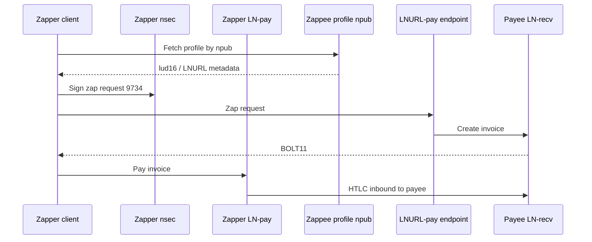
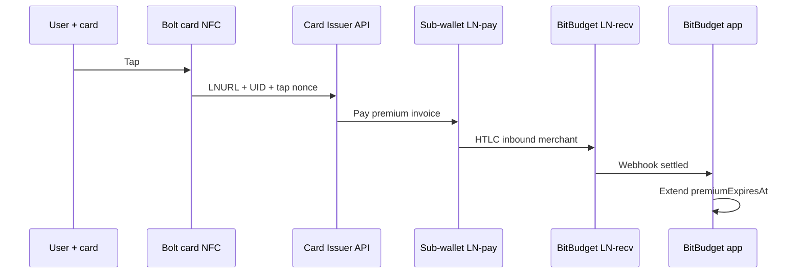
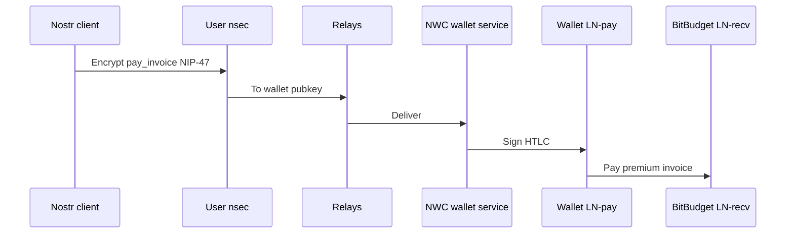
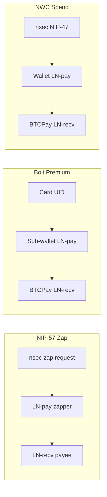

# Lightning Network Operations & Nostr Payment Links

Operator and architecture notes for BitBudget as a **Lightning merchant** (premium Bolt card taps, BTCPay checkout), treasury liquidity, and how **Nostr identity** connects to receive/spend rails — without conflating **npub/nsec** with HTLC signing.

Complements [startos-v04.md](startos-v04.md) (StartOS BTCPay setup) and [bolt-card-platform.md](bolt-card-platform.md) (card manufacturing and activation).

---

## Table of Contents

1. [BitBudget’s role on Lightning](#1-bitbudgets-role-on-lightning)
2. [Channel basics](#2-channel-basics)
3. [Liquidity at scale (1M taps/day)](#3-liquidity-at-scale-1m-tapsday)
4. [Welcome credit and vendor spend](#4-welcome-credit-and-vendor-spend)
5. [Liquidity swaps and rebalancing](#5-liquidity-swaps-and-rebalancing)
6. [Payment rails: Zap, Bolt premium, NWC](#6-payment-rails-zap-bolt-premium-nwc)
7. [npub as receive address](#7-npub-as-receive-address)
8. [nsec and HTLC signing](#8-nsec-and-htlc-signing)
9. [Lightning Address and NIP-57 on StartOS](#9-lightning-address-and-nip-57-on-startos)
10. [Related docs](#10-related-docs)

---

## 1. BitBudget’s role on Lightning

**Premium renewal:** Users pay **BitBudget** via Bolt card, app invoice, or NWC. BitBudget is the **merchant** — payments are **inbound** to BTCPay/LND, like e-commerce checkout.

```text
User card / wallet  ──Lightning──▶  BitBudget BTCPay store (merchant)
```

**Not** the outbound-heavy “treasury pays on users’ behalf” model for subscription taps. User sub-wallets (if custodial) pay **toward** the merchant endpoint; liquidity planning is **inbound-first**.

**Secondary outbound:** BitBudget may pay vendors (hosting, accounting) over Lightning — **outbound** that helps rebalance channels after heavy inbound premium volume.

**Connectivity:** StartOS 0.4 **StartTunnel** clearnet for BTCPay and Card Issuer API; webhooks from BTCPay to Vercel work over Tor exit to clearnet. See [startos-v04.md](startos-v04.md).

---

## 2. Channel basics

Each Lightning channel is a two-sided bucket between you and one peer:

| Side | Meaning for **you** |
|------|---------------------|
| **Local balance** | Sats you can **send out** on this channel |
| **Remote balance** | Sats peer can send **to you** (= your **inbound** capacity on this link) |

| You… | Local | Remote (inbound) |
|------|-------|------------------|
| **Receive** payments | ↑ increases | ↓ decreases |
| **Send** payments | ↓ decreases | ↑ increases |

**Merchant symptom (BitBudget premium):** After many **inbound** payments, **inbound capacity runs low** — “channel is full, cannot receive another payment” — even though **local balance is high** (you could send out).

**Vendor outbound helps:** Paying hosting/accounting over Lightning **reduces local balance** and **restores inbound capacity** on the same channels.

```text
After many inbound premium taps:

  YOU  |= local (high — can send)           |  PEER
       |-------- remote (low — hard to receive more) -------|

After paying vendor on same channel:

  YOU  |======== local (lower) ========|  PEER
       |-------- remote (higher) ------|
```

---

## 3. Liquidity at scale (1M taps/day)

Illustrative planning for **1M successful Lightning payments received per day** (premium + any card spend to BitBudget).

### Traffic

| Metric | Value |
|--------|-------|
| Daily payments | 1,000,000 |
| Average rate | ≈ 11.6 / sec |
| Peak (3–5×) | ≈ 35–58 / sec |
| HTLC duration | ~1–3 sec |
| Concurrent HTLCs at peak | ~100–120 (order of magnitude) |

Concurrent HTLC count is usually **not** the bottleneck; **inbound capacity** and **daily received volume** are.

### Volume (sats)

At illustrative BTC ≈ $100k:

| Mix | Avg payment | Daily received |
|-----|-------------|----------------|
| Mostly $5 monthly | ~5,000 sats | ~5B sats (~50 BTC/day) |
| Mixed $5 / $50 annual | ~15,000 sats | ~15B sats (~150 BTC/day) |

### Primary risk: inbound exhaustion

Mitigations:

- Multiple LSP peers with deep **inbound** toward your node
- **Loop In** / submarine swap (on-chain → Lightning) when alerts fire
- Many medium channels vs one giant channel
- **Vendor outbound** as organic rebalance
- **Loop Out** / reverse swap only for cold-storage sweeps (profit), not daily ops

### Hub sizing (rough)

- 3–10 treasury nodes (geo redundancy)
- 5–20 BTC outbound **per node** across many LSP peers (local balance room after receive)
- Plan **Loop In** batches when inbound drops below policy threshold — not 1M swaps/day

### Solvency (virtual ledger)

Prefunded welcome credits are **liabilities**; premium **inbound** retires them in accounting. Invariant:

```text
treasury_assets ≥ sum(user_liabilities) + in_flight_htlcs + policy_buffer
```

Details: [bolt-card-platform.md § Virtual ledger](bolt-card-platform.md#8-virtual-ledger-schema).

---

## 4. Welcome credit and vendor spend

**Welcome credit:** User receives ledger credit (~$5); first premium tap pays BitBudget **inbound**. You largely **receive back** what you credited — net cost ≈ fees, not full subsidy.

**Vendor Lightning spend:** Hosting, accounting, etc. — **outbound** from treasury. After inbound-heavy days, vendor payments **rebalance** channels without Loop Out to chain.

| Flow | Direction | Effect |
|------|-----------|--------|
| Premium tap | Inbound | Local ↑, inbound ↓ |
| Welcome credit | Ledger only until spent | Liability |
| Pay vendor | Outbound | Local ↓, inbound ↑ |
| Sweep to cold | Loop Out | Optional treasury hygiene |

---

## 5. Liquidity swaps and rebalancing

### Why swaps exist

Sats on Lightning are not stuck in the network — they are on the **wrong side** or **wrong peer** of **your** channels. Swaps and rebalance move liquidity or convert chain ↔ LN.

### Circular rebalance

Pay yourself via a circular route. No on-chain; costs routing fees; needs viable routes.

### Submarine swap (trustless atomic)

On-chain payment (hash-locked) ↔ Lightning HTLC (same payment hash). One leg completes or neither does.

**Forward (on-chain → Lightning) — “Loop In” class**

1. Swap provider gives on-chain address locked to hash H + Lightning invoice with hash H
2. You pay on-chain
3. Provider pays your Lightning invoice; preimage links both legs

**Effect:** On-chain ↓, Lightning local balance ↑ — **refill ability to receive/spend on LN**

**Reverse (Lightning → on-chain) — “Loop Out” class**

1. You pay provider’s Lightning invoice
2. Provider sends on-chain BTC locked to same hash

**Effect:** Lightning ↓, on-chain ↑ — consolidate to cold storage

Merchants who **receive all day** often use **reverse** swaps to bank on-chain. BitBudget **receives** premium but **vendor spend** may reduce need for reverse swaps; **forward** swaps matter when **inbound is exhausted**.

### Loop (Lightning Labs)

Productized swap service:

| Product | Direction | Use |
|---------|-----------|-----|
| **Loop In** | On-chain → Lightning | Inbound / local refill |
| **Loop Out** | Lightning → On-chain | Drain to chain |

### Other tools

| Mechanism | Use |
|-----------|-----|
| Inbound liquidity purchase (LSP) | Peer opens toward you |
| Liquidity ads (Amboss, etc.) | Matchmaking |
| Cooperative close + reopen | On-chain expensive; last resort |
| Splicing | Adjust capacity without full close (where supported) |

### BitBudget cheat sheet

| Symptom | Likely cause | Tool |
|---------|--------------|------|
| Cannot **receive** more | Inbound exhausted | Loop In, LSP inbound, vendor outbound |
| Too much on Lightning | High local balance | Loop Out (cold sweep) |
| Premium to **own** BTCPay | Mostly internal routing | Rebalance between peers; fees only |

---

## 6. Payment rails: Zap, Bolt premium, NWC

Three ways sats move in Nostr/Lightning contexts — **which keys touch each leg**.

**Legend**

| Symbol | Meaning |
|--------|---------|
| **npub** | Nostr public identity |
| **nsec** | Nostr private key — signs **Nostr events only** |
| **LN-pay** | Lightning payer wallet/node keys (HTLC signer) |
| **LN-recv** | Lightning payee (BitBudget BTCPay / LND) |
| **Card** | Bolt UID + issuer URL (not HTLC secp256k1 key) |
| **Sub-wallet** | BitBudget-managed LNbits/LDK keys for user |

### 6.1 NIP-57 zap path



| Leg | Keys |
|-----|------|
| Find recipient | **npub** |
| Zap request | **Zapper nsec** |
| Invoice | **LN-recv** creates BOLT11 |
| Pay | **Zapper LN-pay** |
| Receive | **Payee LN-recv** |

Optional zap receipt (kind 9735): **payee nsec** on BTCPay Nostr plugin — user-held; BitBudget server must not hold user nsec.

### 6.2 Bolt card premium path



| Leg | Keys |
|-----|------|
| Activation once | **npub** + extension **nsec** (optional Nostr path) or email/OAuth |
| Tap | **Card** UID; issuer server secrets |
| Pay | **Sub-wallet LN-pay** (custodial) |
| Receive | **BitBudget LN-recv** |

**“Left wallet at home”:** Card is sufficient; no user **LN-pay** on phone required.

### 6.3 NWC spend path (NIP-47)



| Leg | Keys |
|-----|------|
| Nostr transport | **nsec** encrypts/signs NIP-47 messages |
| HTLC | **Wallet LN-pay** — **not nsec** |
| Receive premium | **BitBudget LN-recv** |

**“Left wallet at home”:** Partial — need Nostr client; wallet can be always-on (home node, Alby, etc.).

### 6.4 Comparison



| Path | User carries | Signs Nostr | Signs HTLC | BitBudget merchant receive |
|------|--------------|-------------|------------|----------------------------|
| NIP-57 zap | Phone + wallet/NWC | Zapper **nsec** | Zapper **LN-pay** | If user zaps you |
| Bolt premium | **Bolt card** | At claim only | **Sub-wallet LN-pay** | **Yes** |
| NWC premium | Nostr client | **nsec** (NWC) | Remote **LN-pay** | **Yes** |
| App BOLT11 | Phone wallet | — | User **LN-pay** | **Yes** |

**Product shape:** User chooses **card OR phone wallet OR NWC** for the same BTCPay premium endpoint.

---

## 7. npub as receive address

**npub is not a Lightning address.** It is Nostr identity. Receive works by **linking npub → pay endpoint** in profile or zap flow.

| Mechanism | How npub connects |
|-----------|-------------------|
| **Lightning Address (`lud16`)** | Profile field `you@domain.com` → HTTPS `.well-known/lnurlp` → invoice |
| **LNURL-pay (`lud06`)** | Profile URL → invoice |
| **NIP-57 zaps** | Client reads **npub** → profile → zap endpoint → invoice |

Wallets do not “pay an npub”; they resolve metadata then pay **BOLT11**.

**BitBudget optional receive (tips/zaps):** BTCPay Lightning Address + Nostr plugin; user sets `lud16` in client. Separate from premium checkout.

---

## 8. nsec and HTLC signing

**nsec signs Nostr events** (NIP-01, NIP-04, NIP-57 requests, NIP-47 wallet commands).

**HTLCs are signed by Lightning node/channel keys** in LND, CLN, LDK, Alby hub, etc.

| Action | What signs |
|--------|------------|
| Post note / zap request | **nsec** |
| NWC `pay_invoice` message | **nsec** (transport auth) |
| Actual Lightning payment | **LN-pay** keys on wallet service |
| BitBudget server | Never user **nsec**; never user HTLC keys |

Deriving Lightning keys from Nostr seed is non-standard and discouraged. BitBudget aligns with extension-only signing and [AGENTS.md](../AGENTS.md) privacy rules.

---

## 9. Lightning Address and NIP-57 on StartOS

On StartOS 0.4 with StartTunnel clearnet BTCPay:

1. **Lightning Address** — BTCPay sidebar → add address (`user@yourdomain.com`)
2. **NIP-57 / zaps** — Nostr plugin; link `lud16`, npub; optional nsec for zap receipts (self-custody zaps to LND balance, not LNbits segregated wallet)

Tor latency note: clearnet StartTunnel avoids slow invoice return over Tor for normie wallets.

Setup steps: [startos-v04.md § Lightning Address](startos-v04.md#4-lightning-address-and-nostr-zaps).

---

## 10. Related docs

- [startos-v04.md](startos-v04.md) — StartOS 0.4, StartTunnel, BTCPay webhooks, LNbits Bolt Cards setup
- [bolt-card-platform.md](bolt-card-platform.md) — Manufacturing, activation, virtual ledger, Nostr claim path
- [outbound-messaging.md](outbound-messaging.md) — Nostr DMs for renewal reminders (`lib/notify.ts`)

**External references**

- [LUD-16 Lightning Address](https://github.com/lnurl/luds/blob/master/16.md)
- [NIP-57 Zaps](https://github.com/nostr-protocol/nips/blob/master/57.md)
- [NIP-47 Nostr Wallet Connect](https://github.com/nostr-protocol/nips/blob/master/47.md)
- [Loop (Lightning Labs)](https://lightning.engineering/loop/)
- [BTCPay Greenfield API](https://docs.btcpayserver.org/API/Greenfield/v1/)
