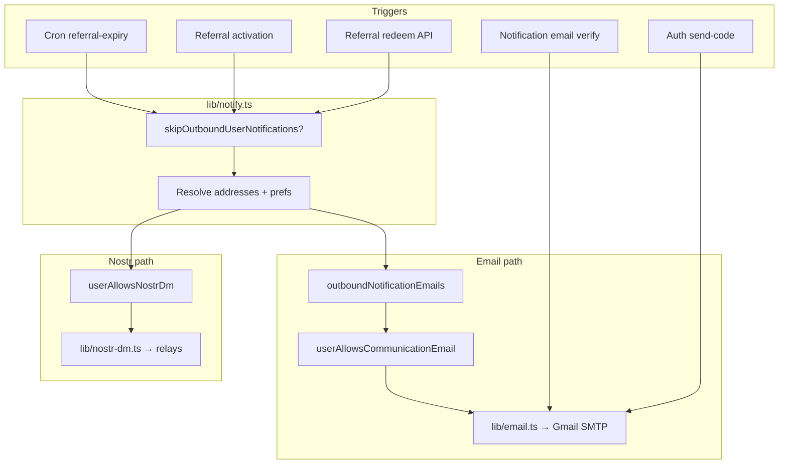

# Outbound messaging (email & Nostr)

BitBudget sends **optional product notifications** (referrals, premium trial/gratis reminders, admin digests, notification-email verification codes, and similar) through two server channels. **Login OTPs** are security messages on the same SMTP stack; they are always sent when needed and are **not** controlled by Communications preference toggles.

| Channel | Implementation | User opt-in |
|---------|----------------|-------------|
| **Email** | Gmail SMTP via Nodemailer (`lib/email.ts`) | Per-category toggles in Settings → Communications; security/login codes always sent when needed |
| **Nostr DM** | NIP-04 kind 4 events (`lib/nostr-dm.ts`) | `User.nostrDmEnabled` in Settings → Communications (requires `User.nostrPubkey`) |

Channels are **independent**: a user can use multiple verified notification emails **and** Nostr DMs at the same time. See [How routing works](#how-routing-works).

**Related (inbound, not covered here):** receipt email forwarding — [email-forwarding-setup.md](./email-forwarding-setup.md).

---

## How routing works



**Email recipients** (`lib/notification-contact.ts`):

1. Login `User.email` (if present) — always included for notifications.
2. Every row in `UserNotificationEmail` with a verified `verifiedAt` (up to 10 per user).

Preference-gated product email is sent to **each** address in that list when the category is allowed.

**Nostr DMs** (`lib/notify.ts`):

- Sent when `nostrDmEnabled` is true and `nostrPubkey` is set.
- Sent **in addition to** email when both are configured (not as a fallback only).

**Skipped entirely** when `E2E_TEST=true` (Playwright / CI). Never set that in preview or production.

**Code map:**

| Concern | Location |
|---------|----------|
| Dispatch & preference gates | `lib/notify.ts` |
| Address resolution | `lib/notification-contact.ts` |
| Link/verify notification emails | `lib/notification-email-link.ts`, `app/api/user/notification-email/route.ts` |
| SMTP + templates | `lib/email.ts` |
| NIP-04 publish | `lib/nostr-dm.ts` |
| User toggles | Settings → Communications (`components/communication-channels-card.tsx`) |
| Unsubscribe | `GET /api/user/unsubscribe?token=…&category=…` shows a confirmation page; `POST` applies the preference change (safe for email link scanners) |

---

## Environment variables

Copy from [`.env.example`](../.env.example). Minimum for local app boot: `DATABASE_URL`, `AUTH_SECRET`. Outbound messaging is optional until you configure the variables below.

### Email (Gmail SMTP)

| Variable | Required | Description |
|----------|----------|-------------|
| `GMAIL_USER` | For real sends | Gmail address used as SMTP user and `From:` |
| `GMAIL_APP_PASSWORD` | For real sends | [Google App Password](https://myaccount.google.com/apppasswords) (not your main Gmail password) |
| `NEXTAUTH_URL` | For unsubscribe links | Canonical app URL (see [Preview vs production](#preview-vs-production)) |

If `GMAIL_USER` / `GMAIL_APP_PASSWORD` are unset, `lib/email.ts` logs to the server console instead of sending mail: **subject and recipient** for general HTML mail, and the **6-digit code only** for auth/notification verification emails (not full message bodies). That is the expected local-dev default.

**Also uses `NEXTAUTH_URL`** when set; otherwise `resolveEmailAppUrl()` in `lib/app-url.ts` picks `VERCEL_URL` on preview deploys and `VERCEL_PROJECT_PRODUCTION_URL` only when `VERCEL_ENV=production`.

### Nostr (service account DMs)

| Variable | Required | Description |
|----------|----------|-------------|
| `BITBUDGET_NOSTR_NSEC` | For DMs | Service account secret: `nsec1…` (NIP-19) or 64-char hex. **Server-only** — never expose to the client or commit to git. |
| `BITBUDGET_NOSTR_RELAYS` | Optional | Comma-separated `wss://` relay URLs. Defaults: `relay.damus.io`, `nos.lol`, `relay.nostr.band` |

If `BITBUDGET_NOSTR_NSEC` is unset, `sendNostrDm` logs a warning and returns `false` (no throw).

**MVP default:** Leave `BITBUDGET_NOSTR_RELAYS` unset (built-in clearnet relays) or set a short list of well-known public relays. That is sufficient for product notifications today.

### CI / E2E only

| Variable | Where | Description |
|----------|-------|-------------|
| `E2E_TEST` | Playwright only | `true` disables all `lib/notify.ts` outbound email/DM |
| `E2E_EMAIL_CODE` | Playwright only | Fixed 6-digit OTP for `*@bitbudget.test` (default `424242`) |

### Cron (premium expiry notifications)

| Variable | Description |
|----------|-------------|
| `CRON_SECRET` | Bearer token for `GET /api/cron/referral-expiry` (see `vercel.json`) |

---

## Local development setup

### 1. Database and auth

```bash
pnpm install
# .env.local: DATABASE_URL, DATABASE_URL_UNPOOLED, AUTH_SECRET (≥32 chars)
pnpm prisma migrate deploy
pnpm dev
```

### 2. Email (optional)

1. Create a dedicated Gmail (or Google Workspace) mailbox for dev, e.g. `notifications-dev@yourdomain.com`.
2. Enable 2FA on the Google account → **App passwords** → create an app password for “Mail”.
3. In `.env.local`:

```bash
GMAIL_USER="notifications-dev@yourdomain.com"
GMAIL_APP_PASSWORD="xxxx xxxx xxxx xxxx"
NEXTAUTH_URL="http://localhost:3000"
```

4. Trigger a login OTP: open `/auth`, enter your email, watch the terminal (or inbox if SMTP is set).

5. **Notification email linking (Nostr user flow):** sign in with Nostr → Settings → Communications → add an address → use the verification code email (or console log without SMTP).

### 3. Nostr DMs (optional)

1. Generate a **dedicated service key** (not a user login key):
   - Extension or `nak` / `nostr-tools`: create new keypair for “BitBudget Notifications Dev”.
   - Store **only** the `nsec` in `.env.local` as `BITBUDGET_NOSTR_NSEC`.
2. Optional relays:

```bash
BITBUDGET_NOSTR_RELAYS="wss://relay.damus.io,wss://nos.lol"
```

3. In the app: Nostr user → Settings → Communications → enable **Nostr direct messages**.
4. Trigger a referral or cron notification (see [Manual verification](#manual-verification)); confirm kind 4 events on relays with a Nostr client logged in as the **recipient** pubkey.

### 4. What to expect without SMTP / nsec

| Action | Without `GMAIL_*` | Without `BITBUDGET_NOSTR_NSEC` |
|--------|-------------------|--------------------------------|
| Login OTP | Code printed in terminal | — |
| Notification verify code | Code printed in terminal | — |
| Product email (referral, trial, etc.) | Subject and recipient logged (not full HTML body) | — |
| Product Nostr DM | — | `[nostr-dm] BITBUDGET_NOSTR_NSEC not configured` |

### 5. Playwright / unit tests

- `pnpm test` mocks email/Nostr; no live network.
- `pnpm test:e2e` sets `E2E_TEST=true` in `playwright.config.ts` so `lib/notify.ts` never sends outbound mail/DMs.
- Do **not** add `E2E_TEST` to `.env.local` while manually testing real SMTP or DMs.

---

## Tor-only relays (post-MVP)

Running your **own** relay reachable only over Tor (hidden service, no public DNS listing) fits a strong threat model: the publish endpoint is not advertised on the open internet, and casual relay crawlers never index it. **That mode is not supported by the current codebase** and is **not required for MVP**. Ship Nostr DMs via well-known public `wss://` relays until you add Tor-aware publishing.

### What the app does today

| Capability | Supported? | Notes |
|------------|------------|--------|
| Publish kind 4 DMs to clearnet relays | Yes | `lib/nostr-dm.ts` → `SimplePool.publish()` |
| Publish to `wss://….onion` via Tor | **No** | No SOCKS/Tor integration |
| Subscribe / receive events on a relay | **No** | Server never listens for inbound Nostr |
| Vercel serverless → Tor network | **No** | No Tor daemon or proxy in that runtime |

Outbound Nostr is **publish-only**. Users read DMs in their own client (Damus, Amethyst, etc.) from whatever relays that client uses. BitBudget does not run a relay and does not ingest replies.

### Why Tor-only URLs fail today

`BITBUDGET_NOSTR_RELAYS` is passed straight into `nostr-tools` `SimplePool`, which opens a normal WebSocket:

- **Node (API routes, cron):** needs a Tor SOCKS proxy (e.g. `127.0.0.1:9050`) and a WebSocket client configured with `socks-proxy-agent` (or similar). None of that exists in this repo.
- **Vercel / typical PaaS:** cannot reach `.onion` hosts; no local Tor process.
- **Browser (`fetchNostrProfile`):** uses hardcoded clearnet relays in `lib/nostr-local-signer.ts`; the web app cannot open `.onion` WebSockets without Tor Browser and code changes.

Setting `BITBUDGET_NOSTR_RELAYS=wss://yourrelay.onion` on a standard deploy will usually produce `[nostr-dm] publish failed` in logs.

### MVP: public relays (recommended)

For launch, configure only:

```bash
BITBUDGET_NOSTR_NSEC="nsec1…"   # dedicated service key, per environment
# Optional; omit to use defaults in lib/nostr-dm.ts:
# BITBUDGET_NOSTR_RELAYS="wss://relay.damus.io,wss://nos.lol,wss://relay.nostr.band"
```

`pool.publish` uses `Promise.any` — one successful relay is enough. Public relays improve deliverability because many clients already read them.

### Post-MVP: Tor relay threat model (operator view)

**Goals Tor-only relaying can help with:**

- Hide **your** relay’s hostname from public DNS and relay directory scrapers.
- Reduce correlation between “BitBudget notification infrastructure” and a trivially discoverable domain.
- Keep publish traffic off default public relays if policy or jurisdiction matters.

**What Tor does *not* solve by itself:**

- Users must still **read** from a relay that holds the event. If you publish only to a Tor-only relay, recipients need a Tor-capable Nostr client pointed at that relay (or you also publish to clearnet relays — see hybrid below).
- The service `nsec` still identifies the **publisher** on Nostr; Tor hides the relay host, not the cryptographic author.
- Login/signing still goes through the user’s extension and its relay set unless you change those flows separately.

### Post-MVP: implementation sketch

When you prioritize Tor support, plan a **self-hosted publisher** (not Vercel-only):

1. **Tor on the host** — `tor` with SOCKS on `127.0.0.1:9050` (or `9150` for Tor Browser bundle style).
2. **SOCKS-aware WebSocket** — e.g. `ws` + `socks-proxy-agent` with `socks5h://127.0.0.1:9050` so `.onion` hostnames resolve through Tor; wire into `nostr-tools` via `useWebSocketImplementation` (see [nostr-tools pool docs](https://github.com/nbd-wtf/nostr-tools)).
3. **Relay URL** — hidden service v3, e.g. `wss://abc123….onion` (TLS on onion is relay-specific; follow your relay software’s docs).
4. **Optional dual publish** — publish to your Tor relay **and** one public relay during migration so users on clearnet-only clients still receive DMs:
   ```bash
   BITBUDGET_NOSTR_RELAYS="wss://yourhidden.onion,wss://nos.lol"
   ```
   Only works once Tor WebSocket plumbing exists on that host.
5. **Profile metadata** — `fetchNostrProfile` today ignores `BITBUDGET_NOSTR_RELAYS`; Tor-only profile hosting would need the same SOCKS WebSocket work or a clearnet mirror for kind 0.

**Inbound / “receive” on Tor:** Not planned in the current product. Adding it would mean long-lived subscriptions, event storage, and NIP handling on your infrastructure — separate from outbound DMs.

### Operator checklist (future Tor publisher)

- [ ] Relay hidden service stable; `wss` endpoint tested with `nak` or a Tor SOCKS client **from the same network path as the app**
- [ ] Dedicated notification `nsec`; never reused as a user login key
- [ ] Publisher runs on host with Tor (VM, container with sidecar Tor, or bare metal) — not serverless-only
- [ ] Document which relay(s) users must add in their Nostr client if you skip dual publish
- [ ] Monitor publish failures; fallback relay in env if Tor path is down

### Troubleshooting (Tor)

| Symptom | Cause | MVP workaround |
|---------|--------|----------------|
| `publish failed` to `.onion` | No Tor/SOCKS on app host | Use public relays in `BITBUDGET_NOSTR_RELAYS` or unset |
| User never sees DM | Client not on your Tor relay | Dual-publish to a public relay, or document client relay config |
| Works on laptop, fails in prod | Vercel cannot use Tor | Run publisher on Tor-capable infra |

---

## Preview vs production

BitBudget is typically deployed on **Vercel** with separate **Preview** (per-PR / branch) and **Production** environments. Configure env vars in **Project → Settings → Environment Variables** and scope each variable to Preview, Production, or both.

### URLs and unsubscribe links

| Environment | Set `NEXTAUTH_URL` to | Notes |
|-------------|------------------------|-------|
| **Production** | `https://bitbudget.io` (or your prod domain) | Stable unsubscribe and auth callback URLs |
| **Preview** | `https://<branch>-<team>.vercel.app` **or** rely on Vercel’s auto `VERCEL_URL` | Per-deploy URL changes unless you use a fixed preview domain |
| **Local** | `http://localhost:3000` | Match the port you use for `pnpm dev` |

`lib/email.ts` builds unsubscribe links from `NEXTAUTH_URL` first. If preview deploys use the wrong host, users get broken unsubscribe links — set `NEXTAUTH_URL` explicitly for a stable preview hostname when you have one.

### Recommended split

| Secret / config | Production | Preview | Local |
|-----------------|------------|---------|-------|
| `GMAIL_USER` | Prod notifications mailbox | Dev mailbox (recommended) | Dev mailbox |
| `GMAIL_APP_PASSWORD` | Prod app password | Dev app password | Dev app password |
| `BITBUDGET_NOSTR_NSEC` | **Prod-only** service nsec | **Separate** dev nsec | Dev nsec |
| `BITBUDGET_NOSTR_RELAYS` | Prod relay list | Same or dev relays | Optional |
| `NEXTAUTH_URL` | Production domain | Preview URL | `http://localhost:3000` |
| `E2E_TEST` | **Unset** | **Unset** | **Unset** (only Playwright sets it) |
| `DATABASE_URL` | Prod Postgres | Preview/staging DB | Local Postgres |

Use **different** Gmail and Nostr service keys for preview vs production so test cron jobs and QA never message real users.

### Vercel Postgres

Preview and production should use **different databases**. Run migrations on each:

```bash
# Against preview DB URL
DATABASE_URL="…" pnpm prisma migrate deploy
```

Notification tables: `UserNotificationEmail`, communication preference columns on `User` (see `prisma/migrations/`).

---

## Deployment plan

Use this checklist when enabling outbound messaging in a new environment (preview or production).

### Phase 0 — Prerequisites

- [ ] PostgreSQL provisioned; `DATABASE_URL` and `DATABASE_URL_UNPOOLED` set on Vercel
- [ ] `AUTH_SECRET` set (≥32 characters)
- [ ] `pnpm prisma migrate deploy` run against that database (CI or deploy hook / manual)
- [ ] `NEXTAUTH_URL` set to the environment’s public HTTPS origin

### Phase 1 — Email

- [ ] Create Gmail / Workspace sender for this environment
- [ ] Create Google App Password; store as `GMAIL_APP_PASSWORD` (Sensitive)
- [ ] Set `GMAIL_USER` on Vercel (scoped to Preview and/or Production)
- [ ] Send test login OTP from `/auth` → confirm delivery
- [ ] Sign in as Nostr-only test user → link notification email in Settings → confirm verification email
- [ ] Open a product email (e.g. trigger referral accept) → confirm unsubscribe link uses correct `NEXTAUTH_URL` host

### Phase 2 — Nostr DMs

- [ ] Generate environment-specific service `nsec`; store as `BITBUDGET_NOSTR_NSEC` (Sensitive, server-only)
- [ ] **MVP:** omit `BITBUDGET_NOSTR_RELAYS` or use public clearnet relays only (see [Tor-only relays](#tor-only-relays-post-mvp))
- [ ] Optionally set `BITBUDGET_NOSTR_RELAYS` (not `.onion` until Tor publisher is implemented)
- [ ] Test user: `nostrPubkey` set, `nostrDmEnabled` true in Settings
- [ ] Trigger `notifyReferralAccepted` or cron path → confirm kind 4 received on relays
- [ ] Confirm DMs still send when user also has notification emails linked (both channels)

### Phase 3 — Cron and referrals

- [ ] `CRON_SECRET` set on Vercel (auto-injected in some setups; verify)
- [ ] `vercel.json` cron `referral-expiry` enabled on plan that supports crons
- [ ] After deploy, check Vercel Cron logs for `/api/cron/referral-expiry` (09:00 UTC)
- [ ] Confirm trial/gratis emails respect `emailRenewalReminders` (and DMs respect `nostrDmEnabled`)

### Phase 4 — Safety

- [ ] Confirm `E2E_TEST` is **not** set in Preview or Production
- [ ] Confirm service `nsec` is not in client bundles (`BITBUDGET_*` has no `NEXT_PUBLIC_` prefix)
- [ ] Document which mailbox/relay identity operators should monitor for bounces or abuse

### Rollback

- Unset `GMAIL_*` → product email falls back to console logging (fails closed for users expecting mail unless you monitor logs).
- Unset `BITBUDGET_NOSTR_NSEC` → DMs silently skip; email unaffected.
- Users can disable categories in Settings or unsubscribe via email footer token.

---

## Manual verification

### Email — login OTP

```bash
curl -X POST http://localhost:3000/api/auth/send-code \
  -H "Content-Type: application/json" \
  -d '{"email":"you@example.com"}'
```

Check inbox or dev server logs.

### Email — notification link (authenticated)

Use the UI (Settings → Communications) or:

```bash
# Session cookie required — easier via browser
POST /api/user/notification-email  { "action": "send-code", "email": "notify@example.com" }
POST /api/user/notification-email  { "action": "verify", "email": "notify@example.com", "code": "123456" }
```

### Nostr — referral notification (requires DB fixtures)

1. Referrer user with `nostrPubkey`, `nostrDmEnabled: true`, no login email (or with linked notification emails to test both).
2. Redeem a referral as referee → `POST /api/referral/redeem` calls `notifyReferralAccepted`.
3. Watch server logs for `[nostr-dm] publish failed` vs success.

### Cron — premium expiry (production-like)

Daily at **09:00 UTC** (`vercel.json` → `GET /api/cron/referral-expiry`). Sends **renewal_reminders** email/DM with per-user dedup (`PremiumRenewalReminderLog`):

| Window | When (UTC) | Population |
|--------|------------|------------|
| 14 days before | Expiry calendar date is today + 14 | Trial, referral bonus (gratis), paid membership (`premiumMembershipUntil`) |
| 3 days before | Expiry calendar date is today + 3 | Same |
| 1 day before | Expiry calendar date is tomorrow | Same |
| Expired | Calendar day **after** expiry date (after 04:00 UTC grace ends) | Same |

Copy differs for **trial** vs **membership** (gratis + paid). In-app popup + post-expiry banner use the same schedule; dismissals log `in_app_dismissed` on the same key.

```bash
curl "https://<your-host>/api/cron/referral-expiry" \
  -H "Authorization: Bearer $CRON_SECRET"
```

Expect JSON summary (`nearingSent`, `expiredSent`, …); users in each window receive email and/or DM per their settings.

---

## Security and privacy notes

- **Service nsec** can publish DMs as BitBudget’s bot identity. Rotate if leaked; use per-environment keys.
- **Login email** and **notification emails** are separate for Nostr-only users so they can receive mail without email-based sign-in.
- **Linking sign-in email** to a Nostr account is a separate flow (Data & Security → Linked sign-in methods) with an explicit privacy warning — do not conflate with notification-email linking.
- Unsubscribe tokens are per-user (`emailUnsubscribeToken`); links only disable marketing-style categories, not security OTPs.
- Never log `BITBUDGET_NOSTR_NSEC`, `GMAIL_APP_PASSWORD`, or OTP codes in application telemetry.

---

## Troubleshooting

| Symptom | Likely cause | Fix |
|---------|--------------|-----|
| No email in prod | Missing `GMAIL_*` | Set both vars; redeploy |
| Unsubscribe link 404 / wrong host | `NEXTAUTH_URL` mismatch | Set canonical URL for that deploy |
| OTP in logs only | Expected without SMTP | Add `GMAIL_*` for real delivery |
| No Nostr DM | `nostrDmEnabled` false or no nsec | User toggle + `BITBUDGET_NOSTR_NSEC` |
| DM to wrong person | Wrong `nostrPubkey` on user row | Fix user record; never reuse service nsec as user key |
| Duplicate emails | Multiple linked addresses | By design; remove extras in Settings |
| Preview emails real users | Shared prod DB or mailbox | Separate DB + dev sender per environment |
| CI sends mail | `E2E_TEST` set in Vercel | Remove from Preview/Production |
| DM `publish failed` to `.onion` | Tor not wired in app | Use public relays for MVP; see [Tor-only relays](#tor-only-relays-post-mvp) |

---

## Extending outbound messaging

When adding a new notification:

1. Add template helpers in `lib/email.ts` and/or `lib/nostr-dm.ts`.
2. Export a `notify…` function from `lib/notify.ts` that uses `dispatchPreferenceEmailToUser` or `dispatchToUser`.
3. Respect `COMMUNICATION_EMAIL_SELECT` (include `notificationEmails` relation).
4. Add a communication category in `lib/communication-preferences.ts` if the email should be opt-out capable.
5. Add Vitest coverage under `lib/__tests__/notify-e2e-skip.test.ts` or a dedicated notify test.
6. Update this doc if new env vars or crons are required.
