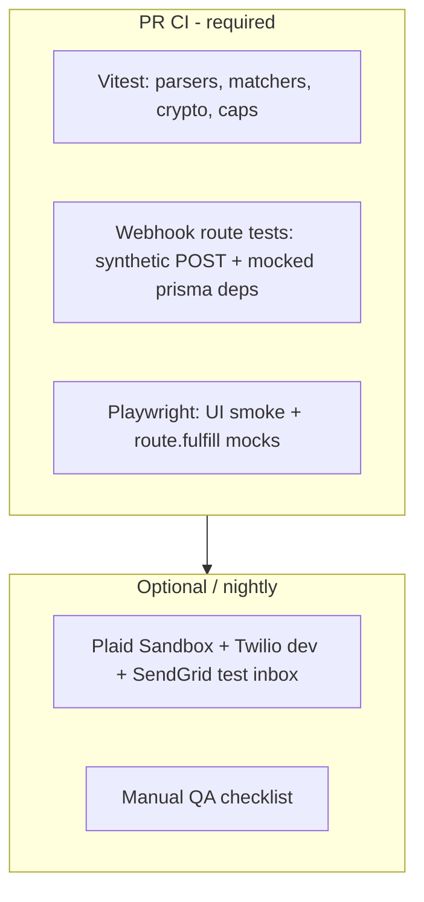

# E2E strategy: third-party integrations (no CI spend)

BitBudget v1 **Playwright CI** must not call paid or rate-limited services: Plaid Link, Twilio SMS, SendGrid inbound, or OpenAI/GPT parsers. This document describes how we still gain **high confidence** in integration behavior through **layered testing**: unit tests on pure logic, **contract tests** on webhook handlers with synthetic payloads, **route interception** in Playwright, optional **sandbox** jobs outside default PR gates, and **manual QA** checklists.

Parent plan: [e2e-v1-coverage-plan.md](./e2e-v1-coverage-plan.md) (core product flows without integrations).

---

## Principles

| Principle | Implementation |
|-----------|----------------|
| **Default PR path is free** | GitHub Actions `e2e` job: mocks/stubs only; no API keys for Plaid/Twilio/SendGrid/OpenAI |
| **Test the contract we own** | Verify signature checks, user resolution, encryption of pending rows, envelope routing, premium caps |
| **Never assert on vendor SDK UI in CI** | Plaid Link iframe is not stable in headless CI; assert our pre/post link API and webhook ingestion |
| **Reuse E2E_TEST guards** | New test-only routes follow `app/api/e2e/*` + `E2E_TEST=true` pattern |
| **Sandbox is opt-in** | Separate workflow or manual `pnpm test:e2e:integrations` with secrets — not required for merge |

---

## Layer model



---

## 1. Plaid

### What production does

| Piece | Path |
|-------|------|
| Link token | `POST /api/plaid/create-link-token` |
| Exchange | `POST /api/plaid/exchange-token` |
| Webhook | `POST /api/webhooks/plaid` (HMAC `Plaid-Verification` / `PLAID-WEBHOOK-SIGNATURE`) |
| Onboarding bank step | **Connect your bank** on referral onboarding |

### CI / Playwright (recommended)

| Layer | Approach |
|-------|----------|
| **Unit / route** | Vitest tests for webhook body parsing with **mocked** `plaidClient` and prisma; assert `PendingTransaction` creation, `activateReferral` when applicable, premium gate |
| **Signature** | Test rejects missing secret, bad HMAC, accepts valid HMAC over fixed `rawBody` |
| **Playwright UI** | **Do not** open Plaid Link in CI. Specs: (1) onboarding referral-bank step shows **Skip for now** and exits to dashboard; (2) Settings Integrations shows Plaid CTA for premium user with **route.fulfill** on `create-link-token` returning fake `{ link_token: "e2e-link" }` — assert error handling if exchange fails (mock 400) |
| **Webhook e2e** | `page.request` or `request` fixture: `POST /api/webhooks/plaid` with test secret from env `PLAID_WEBHOOK_SECRET=e2e-test-secret` and precomputed signature — **no call to Plaid API** |

### Fixture shape (synthetic webhook)

Store minimal JSON under `e2e/fixtures/plaid/`:

- `transactions-sync-available.json` — drives code path that fetches transactions (mock plaid client response in test setup)
- `item-error.json` — error handling

### Optional sandbox job (not PR-blocking)

- GitHub Environment `staging` with `PLAID_CLIENT_ID`, `PLAID_SECRET`, `PLAID_ENV=sandbox`
- Manual workflow: link one sandbox institution, run webhook replay from Plaid dashboard
- Document in PR when changing `app/api/webhooks/plaid/route.ts`

### Privacy / product notes for tests

- Assert pending rows have **encrypted** payee fields (server encrypt); no plaintext payee in API responses to browser without client decrypt.

---

## 2. Receipt inbox (email forwarding to unique address)

### What production does

| Piece | Path |
|-------|------|
| User address | `GET /api/user/receipt-inbox` → `receipts+{token}@parse.bitbudget.io` |
| Inbound | `POST /api/webhooks/inbound-email` (SendGrid multipart + optional ECDSA verify) |
| Client scan | `POST /api/receipts/scan` (OpenAI — **already mocked** in `receipt-scan.prefill.spec.ts`) |

### CI / Playwright (recommended)

| Layer | Approach |
|-------|----------|
| **Settings UI** | Premium seed user: mock `GET /api/user/receipt-inbox` → copy address visible; **Copy** button; free user sees upgrade CTA (no network to SendGrid) |
| **Inbound webhook** | Vitest or dedicated `e2e/plaid-webhook.contract.spec.ts`-style **API test**: build `multipart/form-data` with `to= receipts+{knownToken}@…`, `text` or attachment; **disable** SendGrid verify in test via `SENDGRID_INBOUND_WEBHOOK_PUBLIC_KEY` unset + test-only `E2E_TEST` bypass header **or** inject valid test signature using a fixed test key pair generated once in repo |
| **Parser** | Unit-test `parseReceiptText` / inbound path with fixture `.eml` snippets — no LLM |
| **Premium cap** | Assert `assertPremiumTrialInboxAllowed` returns 429 when over cap (unit test with seeded counts) |

### E2E_TEST bypass (proposed)

Add guarded branch in `inbound-email/route.ts` (only when `E2E_TEST=true`):

- Accept `X-E2E-Inbound-Secret: {E2E_INBOUND_SECRET}` instead of SendGrid signature for tests
- **Never** document this header for production operators

Alternative: keep signature verification and add `lib/__tests__/sendgrid-inbound-verify.test.ts` plus separate handler test that calls internal `processInboundEmail()` extracted function.

### Playwright

- **Do not** send real email in CI.
- Spec: user copies inbox address (mocked GET); webhook test creates `PendingTransaction` via `request.post` with fixture; signed-in user sees pending txn on Transactions (if UI exists) or assert DB via `POST /api/e2e/inspect-pending` (test-only).

### Cost

**Zero** SendGrid mail send; **zero** OpenAI if scan route is not hit. Inbound path uses deterministic text parser fixtures.

---

## 3. SMS alerts

### What production does

| Piece | Path |
|-------|------|
| Webhook | `POST /api/webhooks/sms` (Twilio form POST, `X-Twilio-Signature`) |
| Production verify | `TWILIO_AUTH_TOKEN` + `TWILIO_SMS_WEBHOOK_URL` |

### CI / Playwright (recommended)

| Layer | Approach |
|-------|----------|
| **Unit** | `verifyTwilioWebhookSignature` known vector tests (Twilio docs test vectors) |
| **Route** | In `NODE_ENV=test` or `E2E_TEST`, skip signature verify **or** use Twilio’s official test credentials to compute signature for fixed URL + params |
| **Body** | POST `Body=STARBUCKS $4.50` & `From=+15551234567` mapped to user via `User.smsPhone` seed |

### User resolution seed

```ts
// e2e/seed-sms-e2e.ts
await prisma.user.update({
  where: { email: "e2e-sms@bitbudget.test" },
  data: { smsPhone: "+15551234567", /* premium */ },
})
```

### Playwright

- API-level: after webhook POST, assert pending transaction or parser output in DB via test helper
- UI: Settings Integrations shows SMS instructions (premium); no real SMS send

### Optional dev

- Twilio trial account + one inbound webhook tunnel (ngrok) — **manual only**, documented in QA checklist

### LLM note

SMS route may reference `OPENAI_API_KEY` for parsing — **mock** `fetch` to OpenAI in tests or stub parser module.

---

## 4. Connected email (transactional / inbox)

Clarify two channels:

| Channel | Mechanism | Test approach |
|---------|-----------|---------------|
| **Receipt inbox** | SendGrid inbound → `inbound-email` | Section 2 above |
| **Bank / card email** | User-configured forwarding patterns (if applicable) | Treat like inbox: fixture MIME → webhook |
| **Outbound notify** | `lib/notify.ts` skips when `E2E_TEST` | Assert **no** SMTP in e2e via log hook or mock transport |

### `notify.ts` in e2e

Already skips outbound email/Nostr DMs when `E2E_TEST=true`. Integration specs should **not** assert email delivery — only that referral activation paths don’t throw when notify is suppressed (current referral tests log `Email (no transport)`).

---

## 5. GPT / smart import (explicitly out of v1 e2e)

| Surface | CI approach |
|---------|-------------|
| `POST /api/receipts/scan` | **route.fulfill** (existing receipt-scan spec) |
| Voice `POST /api/voice/parse` | Defer; mock if added |
| SMS/Email LLM parse | Mock parser module in unit tests |

**Nightly optional:** single smoke with `OPENAI_API_KEY` in secret store — **not** merge-blocking.

---

## 6. Proposed test-only API surface

Extend pattern from `app/api/e2e/reset-referral-seed/route.ts`:

| Route | Purpose |
|-------|---------|
| `POST /api/e2e/reset-onboarding-seed` | Fresh `onboardingComplete: false` users |
| `POST /api/e2e/inject-plaid-webhook` | Signs body with `PLAID_WEBHOOK_SECRET` for worker |
| `POST /api/e2e/inject-inbound-email` | Multipart fixture without SendGrid |
| `POST /api/e2e/inject-sms` | Twilio-shaped form POST |
| `GET /api/e2e/pending-transactions?userId=` | Assert ingestion outcomes (no decrypt) |

All return **404** unless `E2E_TEST=true`.

---

## 7. Suggested spec files (integration phase — post v1)

| File | Runs in default CI? |
|------|-------------------|
| `e2e/contracts/plaid-webhook.spec.ts` | Yes (signed synthetic) |
| `e2e/contracts/inbound-email.spec.ts` | Yes |
| `e2e/contracts/sms-webhook.spec.ts` | Yes |
| `e2e/integrations/plaid-link.smoke.spec.ts` | Yes (mocked link token only) |
| `e2e/integrations/plaid-sandbox.spec.ts` | **No** — manual / nightly |
| `lib/__tests__/twilio-webhook-verify.test.ts` | Yes (Vitest) |

---

## 8. Environment variables reference

| Variable | PR CI | Nightly / manual |
|----------|-------|------------------|
| `E2E_TEST` | `true` | `true` |
| `E2E_EMAIL_CODE` | `424242` | same |
| `PLAID_WEBHOOK_SECRET` | `e2e-plaid-webhook-secret` | sandbox secret |
| `PLAID_CLIENT_ID` / `SECRET` | unset | sandbox |
| `TWILIO_*` | unset or test vectors only | trial account |
| `SENDGRID_INBOUND_*` | unset (use inject route) | verify enabled |
| `OPENAI_API_KEY` | **unset** | optional |

---

## 9. Manual QA checklists (when code touches integrations)

Keep one-page checklists in `docs/testing/` (add as needed):

| Checklist | Trigger |
|-----------|---------|
| `plaid-sandbox-qa.md` | Webhook / exchange-token changes |
| `receipt-inbox-qa.md` | Already have [receipt-forwarding.md](./receipt-forwarding.md) |
| `sms-inbound-qa.md` | SMS webhook changes |
| `email-forwarding-qa.md` | Link to [email-forwarding-setup.md](../email-forwarding-setup.md) |

Each checklist: sandbox credentials, single happy path, expected `PendingTransaction` row, privacy warning shown before linking.

---

## 10. Summary matrix

| Integration | Unit / Vitest | Playwright CI | Sandbox / manual |
|-------------|---------------|---------------|------------------|
| Plaid Link UI | — | Mock token APIs; skip iframe | Sandbox Link once |
| Plaid webhooks | HMAC + handler | Synthetic POST | Dashboard replay |
| Receipt inbox UI | — | Mock GET address | Forward one test email |
| SendGrid inbound | Parser fixtures | Inject multipart | Staging inbox |
| SMS Twilio | Signature vectors | Inject form POST | Trial number |
| OpenAI scan | Parser mocks | **fulfill** route | Optional nightly |

This keeps **merge-blocking CI** fast and free while leaving a clear path to validate real vendor behavior before releases.
